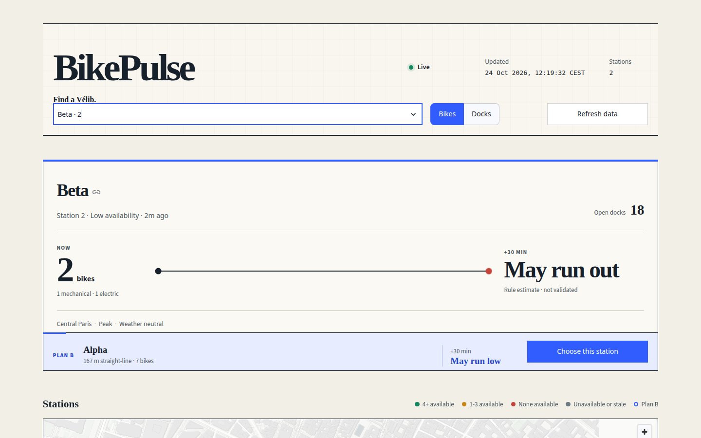
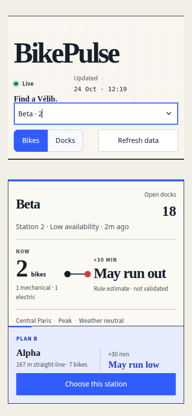

# BikePulse

## Problem

A Vélib’ station with bikes or open docks now may be empty or full by the time a rider arrives.
BikePulse combines live availability across Greater Paris with an explainable, rule-based
outlook for the next 30 minutes. Search for a station or select it on the map, switch between
bikes and docks, and see a nearby alternative when the selected station may run out or fill up.

## Live demo

**[Open BikePulse](https://bikepulse.streamlit.app/)**

The live app uses the public Vélib’ GBFS feeds. Its station map refreshes every minute while
open; the **Refresh data** control requests a new status snapshot immediately.

## Screenshot



*Desktop view at 1440 × 900. This capture uses controlled, synthetic two-station feed and
weather fixtures; the live demo loads current public data.*

## Architecture

```text
Vélib’ GBFS feeds → validated live snapshot → map and station availability
                                      └──────→ eligibility + rule-based outlook
Open-Meteo hourly forecast ──────────────────→ optional weather adjustment
```

| Package | Responsibility |
| --- | --- |
| `feeds/` | Fetch GBFS data and validate records individually. |
| `app/` | Keep the latest snapshot and bounded observations in memory; render the Streamlit map and station decision. |
| `prediction/` | Calculate movement and a 30-minute outlook with pure, versioned rules; provide regional weather. |
| `config/` | Load typed TOML settings and reject unknown options. |

The app has one live availability page. The [architecture guide](docs/architecture.md) traces
the request flow and interfaces; the [data contract](docs/data-contract.md) defines feed
validation and freshness.

## Engineering decisions

- **Preserve uncertainty.** Missing counts remain unknown. Feed receipt, publication,
  station-report and weather-valid times stay distinct. Delayed reports are labeled; stale
  reports and last-known snapshots do not receive an outlook.
- **Make the estimate inspectable.** Current inventory, recent movement, nearby station
  pressure, configured areas, local time and eligible weather feed explicit
  [prediction rules](docs/prediction-rules.md). Suspected rebalancing jumps are excluded.
  One to three available bikes or docks always gives High risk; an already empty or full
  station shows its current state. Both modes use the same turnover assumptions.
- **Degrade visibly.** A failed feed refresh retains labeled last-known availability and
  withholds the outlook. Missing or failed weather is shown as neutral and leaves an
  otherwise eligible estimate available, with a retry cooldown.
- **Bound live state.** Status, station information and weather are cached in memory for
  60 seconds, 24 hours and 15 minutes respectively. Recent movement uses at most 21 distinct
  reports per station from the last 20 minutes; nothing is persisted.
- **Keep the alternative honest.** Plan B requires at least four bikes or docks, a safer
  usable outlook and a station within two kilometres. Its distance is straight-line.

### Mobile view

The same current-inventory → outlook → Plan B sequence fits a 390 × 844 phone viewport.



*Controlled synthetic fixtures, matching the desktop capture.*

## Testing

`make verify` runs Ruff formatting and lint, strict mypy, pytest with an 80% coverage gate,
a dependency audit, source and wheel builds, and Playwright browser smoke tests. Browser
checks exercise the map, bike and dock modes, refresh, Plan B, delayed station reports and
weather failure. Tests use controlled local feed and weather fixtures, never public APIs.

Use `make check` for the checks without the browser stage, or `make smoke` for the browser
stage alone. See [operations](docs/operations.md) for the full verification requirements.

## Limitations

- The outlook is an **unvalidated rule estimate**, not a probability or measured accuracy
  claim. Low risk does not guarantee availability.
- Weather is one hourly [Open-Meteo](https://open-meteo.com/en/docs) forecast at the Paris map
  center, not a station-level observation. A weather failure has no effect on the rule score.
  Weather data is attributed under CC BY 4.0.
- Plan B is a nearby alternative, not a walking or cycling route.
- Missing or stale station data can withhold an outlook. Recent observations disappear on
  process restart; BikePulse stores no feed, weather or prediction history.

## Run locally

Use Python 3.12 and the locked environment:

```bash
make setup
make run
```

Setup installs local tooling under `.tools/` and synchronizes `.venv` from `uv.lock`.
The default settings are in `config.example.toml`; select another TOML file with
`BIKEPULSE_CONFIG=/path/to/config.toml make run`.

For Streamlit Community Cloud, use `streamlit_app.py` as the main file and Python 3.12 as
the runtime. The default configuration needs no secrets or database. Deployment and
troubleshooting details are in [operations](docs/operations.md).
